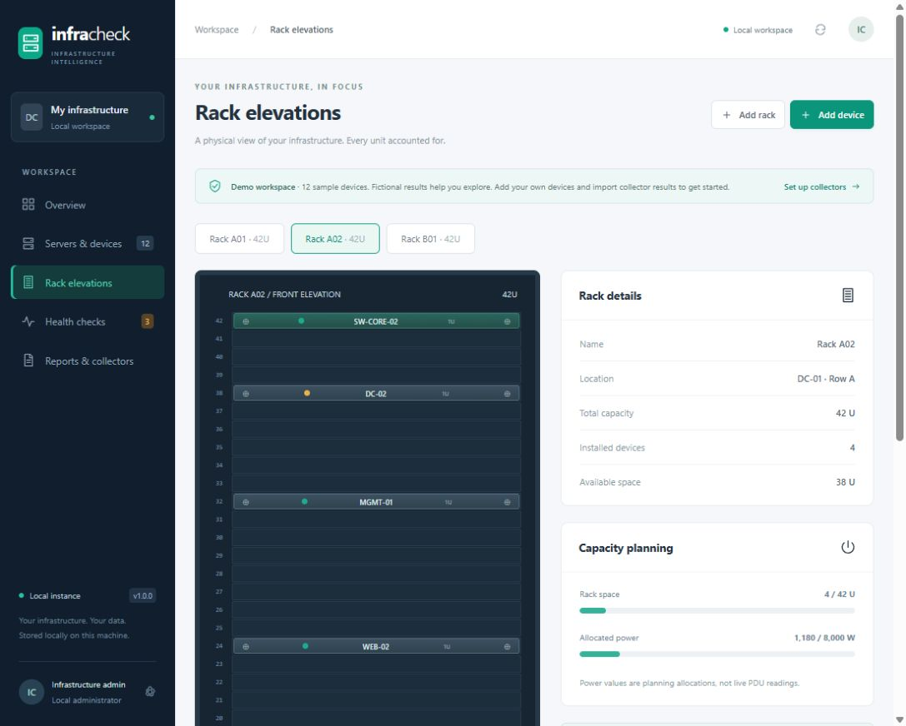
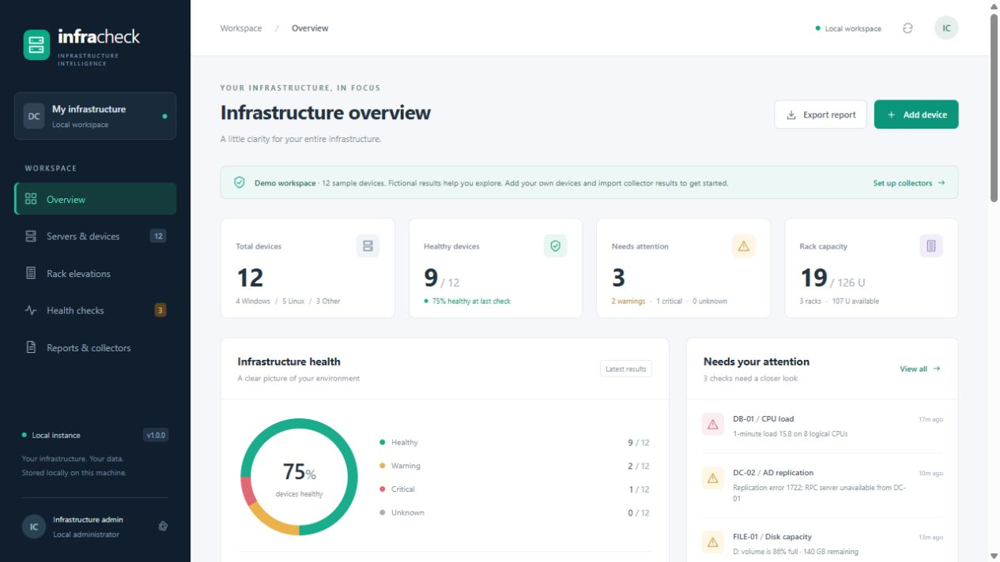
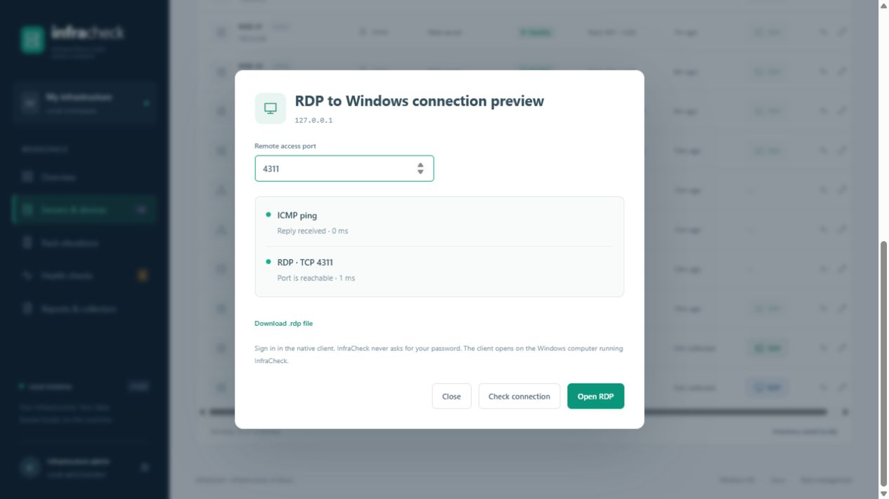
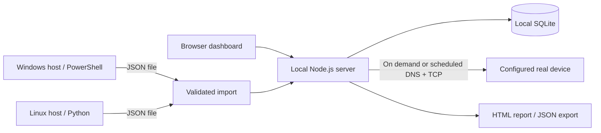

# NodeWatcher

**Windows AD and Linux health checks. Rack elevations. One local workspace.**

NodeWatcher is an infrastructure operations toolkit for administrators and home labs. It combines a local dashboard, physical rack inventory, read-only collectors, and shareable HTML reports. It starts with clearly labeled fictional infrastructure so you can explore before adding real servers.





## Quick start

Requires **Node.js 24 or newer**. No cloud account or API key is required. Install the locked npm dependencies with `npm ci --ignore-scripts` before starting the app.

```sh
git clone <your-repository-url>
cd nodewatcher
npm ci --ignore-scripts
npm start
```

Open **http://127.0.0.1:4310**. From an existing download, run `npm start` in the folder containing `package.json`.

The SQLite database is created automatically in `data/infracheck.db`. Node's built-in SQLite is used. Stop the process with `Ctrl+C`.

PowerShell configuration example:

```powershell
$env:PORT = '4311'
$env:INFRACHECK_DB = './data/lab.db'
npm start
```

Linux configuration example:

```sh
PORT=4311 INFRACHECK_DB=./data/lab.db npm start
```

## Features

| Area | Included |
| --- | --- |
| Dashboard | Health distribution, warnings and critical results, platform counts, rack utilization |
| Inventory | Add, edit, search, filter, and delete Windows, Linux, networking, and storage devices |
| Rack elevations | 1–60U racks, device placement, overlap validation, available U, allocated power budget |
| Connectivity | On-demand DNS resolution and TCP checks against the ports configured for a real device |
| Monitoring | Bounded parallel workers, staggered 5-minute to 24-hour connectivity schedules, local history, metric trends, acknowledgement, silencing, and recovery tracking |
| Change tracking | Local audit timeline for inventory, rack placement, imports, and monitoring settings with searchable before/after field differences |
| Remote access | Ping and service checks, native SSH for Linux, native RDP for Windows, custom ports and SSH usernames |
| Windows | Fixed-disk utilization, configured services, DNS resolution, Windows Time status |
| Active Directory | Replication partner metadata and DCDiag diagnostics, enabled with `-DomainController` |
| Linux | Load per CPU, available memory, filesystem and inode usage, failed systemd units, DNS, NTP state |
| Reports | Standalone HTML health and rack report; JSON inventory and results export |
| Persistence | Local SQLite; validated imports; demo and real devices kept separate |

Rack units increase from bottom to top. A device's `startU` is its **lowest** occupied unit. A 2U server at U10 occupies U10–U11. Device height supports 1–20U. Devices can also remain unassigned to a rack.

To choose a position, click an **empty U** in the rack elevation and select an existing device, or choose **Add a new device here**. To reposition an installed device, click the device and use the **Starting U** dropdown in its editor. The list shows the full occupied range and disables positions that overlap other devices or extend beyond the rack. Availability updates when you change the rack or device height. Moves between racks preserve the device's health results and remote-access settings.

Power values are manually entered planning allocations, **not measured PDU telemetry**. Exceeding a rack's power budget produces a visible warning; placement validation enforces physical space.

## Connect your infrastructure

1. Open **Rack elevations → Add rack** and enter the rack capacity and power budget.
2. Open **Servers & devices → Add device**. Use a stable ID such as `prod-dc-01` or `lab-linux-01`.
3. Set a resolvable hostname/IP and only the TCP ports you want to check. Changing a device's host, platform, or TCP ports clears its previous results to avoid attributing old checks to a new target.
4. Open **Health checks** and choose **Run connectivity checks** for that device.
5. Run the appropriate collector locally on the target host, using its inventory ID.
6. Transfer the resulting JSON to this machine and use **Reports & collectors → Import JSON**.
7. Export the HTML report when you want a snapshot.

Demo devices use documentation-only addresses in `192.0.2.0/24` and fabricated results. NodeWatcher does not scan them or allow real collector results to be attached to them. Create your own devices to monitor real hosts. You can remove individual sample devices using their edit dialog.

### Connect with SSH or RDP



Each real Linux device has an **SSH** button, and each real Windows device has an **RDP** button in the inventory and health views.

1. Click the device's SSH/RDP button. NodeWatcher checks ICMP ping and the remote-access TCP port.
2. Use the defaults (**SSH 22**, **RDP 3389**) or enter a custom port. For SSH, optionally supply the login username. Save preferred values in the device editor.
3. Once the service port responds, click **Open SSH** or **Open RDP**. NodeWatcher rechecks the port immediately before launching the native client.
4. Complete authentication in the new client window. Passwords and private keys are never collected by the dashboard.

On Windows, SSH opens the built-in OpenSSH client in an interactive console; RDP opens Remote Desktop Connection (`mstsc.exe`) with a credentials prompt. The client opens **on the computer running the NodeWatcher server**. The server must run in your interactive desktop session for the client window to be visible. An SSH command and a downloadable `.rdp` file are also available after a successful port check, including when NodeWatcher runs on another OS or a native client is missing.

Ping success alone does not prove SSH/RDP is available. A responding service port enables connection even when ICMP is blocked. A TCP check verifies port reachability, not protocol negotiation or authentication. Closed ports, demo devices, and unsupported device types cannot launch a client. Connection checks are on demand and do not modify imported health results or automatically enable remote services.

The connection panel's port override applies to that connection; saving the remote-access port in the device editor sets the default for future connections. These remote-access checks are independent of the inventory's general TCP health-check port list.

Native clients keep their normal host-key/certificate checks. The server accepts only validated inventory targets, numeric ports, and restricted SSH usernames; no remote shell command or executable path can be supplied by a browser request.

Client references: [Microsoft OpenSSH documentation](https://learn.microsoft.com/en-us/windows-server/administration/openssh/openssh_install_firstuse) and [Remote Desktop Connection command](https://learn.microsoft.com/en-us/windows-server/administration/windows-commands/mstsc).

### Windows / Active Directory collector

Run on the Windows server being inspected, with Windows PowerShell 5.1 or newer:

```powershell
.\scripts\Collect-Windows.ps1 `
  -ServerId prod-dc-01 `
  -DomainController `
  -DnsName example.test `
  -OutputPath .\reports\prod-dc-01.json
```

For a member server, omit `-DomainController`. The default required services are `EventLog` and `W32Time`. Customize them with `-RequiredServices EventLog,W32Time,LanmanServer`. A DC additionally checks `NTDS`, `DNS`, `Netlogon`, `DFSR`, and `Kdc`; customize the script if your DC does not host DNS.

AD replication requires the **ActiveDirectory PowerShell module**, suitable replication read permissions, and a domain controller target. DCDiag must be installed. Run elevated where your environment requires it. Missing tools, permissions, or unrecognized time output produce **Unknown**, rather than a false success. No replication partners also produces Unknown for review. Diagnostic processes have timeouts.

The collector reads local state; it does not change services, AD, firewall rules, or time configuration. Follow your organization's script execution policy; NodeWatcher does not bypass it.

### Linux collector

Copy `scripts/collect_linux.py` to the host. Requires **Python 3.9+**; systemd-specific checks use `systemctl` and `timedatectl` when available.

```sh
python3 scripts/collect_linux.py \
  --server-id lab-linux-01 \
  --dns-name example.test \
  --output reports/lab-linux-01.json
```

The collector uses `/proc` and local filesystem statistics. Network filesystem capacity is marked Unknown to avoid blocking I/O; unsupported checks are also Unknown. No third-party Python packages are required. Most checks do not require root.

### Health and freshness

- **Healthy**: all collected checks passed.
- **Warning**: at least one collected check crossed a warning threshold.
- **Critical**: at least one collected check failed or crossed a critical threshold.
- **Unknown**: nothing has been collected, or at least one check cannot be evaluated and no warning/critical result takes precedence.

Disk, inode, and memory defaults: warning at **80%**, critical at **95%**. Linux CPU load: warning at **1 load unit per logical CPU**, critical at **2**. AD replication warns if a partner has no successful replication within 24 hours.

These are screening thresholds, not universal production baselines. Connectivity-only results do not prove OS or AD health. OS collection timestamps are tracked separately so running TCP checks does not refresh old system checks. Results older than 24 hours are labeled stale in the health view; historical health badges still describe the last collection, not current availability.

Open **Monitoring** to enable scheduled DNS and configured TCP checks every 5 minutes to 24 hours. Monitoring is disabled by default, skips demo devices, runs only while the local NodeWatcher process is open, and keeps results in the same local database. A configurable worker pool limits simultaneous checks to 1–200 (25 by default). Scheduled starts are spread across 80% of the interval instead of hitting every device at once; manual runs use the worker pool immediately. Overlapping work on the same device is skipped. The page reports duration and skipped-device counts.

Monitoring creates in-app warning/critical alerts, supports acknowledgement and temporary silencing, and records recoveries when a check becomes healthy again. Increase worker count carefully: the useful value depends on NodeWatcher host resources, DNS capacity, firewall rate limits, and WAN links.

CPU, RAM, disk, service, AD, and signed-in-user data still comes from an imported collector snapshot or an approved **Investigate** request. Schedule collectors with Task Scheduler or cron if you need recurring OS metrics; automated collector transport/import and external email/SMS delivery are not included. Numeric metrics present in imported or diagnostic results are charted on the Monitoring page.

## Import/export format

See [example inventory](examples/inventory.json) and [example collector output](examples/collector-result.json). Import the example inventory first if you want to try the sample result. Update its timestamp before using it as a fresh result.

Collector output:

```json
{
  "version": 1,
  "results": [{
    "serverId": "lab-linux-01",
    "checkedAt": "2026-10-25T08:00:00Z",
    "checks": [{
      "name": "Filesystem /",
      "status": "warning",
      "category": "system",
      "message": "84% used; 16 GiB available."
    }]
  }]
}
```

Categories `network`, `system`, `ad`, and `time` distinguish check types. TCP refresh replaces network-category checks and retains the latest imported system/AD checks. An imported collector record replaces the device's current check snapshot; there is no cross-collector aggregation. Results are ordered by their collection timestamps, not import order.

Imports are validated before saving and are limited to 2 MB. A collector result must reference an existing real device. Inventory imports add **new IDs**; collisions are rejected to prevent accidental overwrites. JSON export is useful for analysis and archival, but is not a full workspace restore command. For a full backup/restore, stop NodeWatcher and copy the entire ignored `data/` directory. Treat reports and backups as internal infrastructure data.

The newest 5,000 imported/scan records are retained. This is a local operations tool, not a long-term metrics database.

## Change tracking

The **Change tracking** page records device creation, edits and deletion; rack creation and placement changes; collector imports; and monitoring schedule changes. Each event includes the local actor label, timestamp, affected object, and tracked before/after values. Search and type filters work locally, and JSON export includes the audit timeline. Up to 5,000 events are retained.

Tracking begins after this feature is installed; it does not reconstruct older changes. Health samples remain in Monitoring history so routine polling does not flood the configuration audit log. Passwords, private keys, and transient repair credentials are not tracked fields. Because NodeWatcher currently has one local administrator rather than individual authentication, the actor is recorded as **Local administrator**.

## Architecture



```text
public/          Dashboard, inventory, rack elevation, report controls
lib/             Validation, SQLite storage, demo fixtures, TCP/DNS checks
scripts/         Windows and Linux collectors
examples/        Import format examples
test/            Validation and API integration tests
.github/         Windows/Linux CI workflow
data/            Local runtime data (ignored by Git)
server.js        Loopback-only HTTP server and API
```

## Development and verification

```sh
npm test
node --check server.js
node --check public/app.js
python3 -m py_compile scripts/collect_linux.py
```

Tests cover rack overlap and boundaries, import atomicity, input validation, demo protection, TCP checks against a temporary loopback listener, collector timestamp preservation, and HTML escaping. CI runs Node tests on Windows and Linux, parses the PowerShell collector, and runs the Linux collector on the CI host.

Remote-access tests also cover SSH/RDP selection, custom ports, command-injection rejection, blocked ICMP with an open service port, refusal to launch against a closed port, and client argument generation. Tests use a mock launcher; actual remote authentication must be verified against your own host.

The Windows collector has been smoke-tested on a Windows workstation. Actual DC diagnostics and Linux host collection need validation in your own lab; a syntax check or CI configuration is not a production certification.

## Local deployment boundary

NodeWatcher binds to `127.0.0.1` and validates Host and Origin headers. It has no multi-user login, remote agent authentication, or role-based access control. Keep it as a local application; do not expose it through a public reverse proxy without implementing authentication and deployment hardening. The server process needs network access to configured devices for connectivity checks; collectors run on their hosts using the invoking user's permissions.

## Publish to GitHub

Create an empty repository named `nodewatcher`, then run from this directory:

```sh
git init -b main
git add .
git commit -m "Build NodeWatcher infrastructure toolkit"
git remote add origin https://github.com/YOUR_USERNAME/nodewatcher.git
git push -u origin main
```

The `.gitignore` excludes the database, collector outputs, and generated reports. Review the staged files before publishing. Suggested repository description: **Windows AD & Linux health-check toolkit with rack elevations, local inventory, and HTML reports.**

Suggested topics: `sysadmin`, `active-directory`, `linux`, `powershell`, `datacenter`, `homelab`, `monitoring`, `rack-elevation`.

## License

[MIT](LICENSE).

## Laptops, PCs, and user assignments

Choose **Laptop** or **Desktop PC** in the device editor. Set an optional assigned user (for example `LAB\alex`) and office/desk location. These devices do not require rack placement. Existing inventory remains compatible and defaults to Server, Network device, or Storage.

Open **Users & devices** to search by user, device, address, or location. Assigned users are inventory records, separate from observed sign-ins. Run the updated collector on the device and import its JSON through **Reports & collectors** to update observed users. This is an on-demand snapshot, not live presence; collection time is displayed and snapshots older than 24 hours are marked stale. Connectivity checks do not refresh user snapshots. A newer collector result without session data displays Not collected rather than reusing older session data.

Windows reports the console user from `Win32_ComputerSystem.UserName` (including a locked console); it does not enumerate RDP sessions. Linux reports `who` login records, which may omit graphical sessions. Empty results mean no users were reported within that collector's scope; failed collection displays Unavailable. Assigned and observed usernames are included in local JSON exports; treat these files as internal data.

## Investigate and approve a repair

In **Health checks**, select **Investigate & repair** on a real Windows or Linux device. Enter management credentials for that request. NodeWatcher samples CPU and RAM, shows process details, and checks its supported services. CPU/RAM >=80% produces a dashboard warning; >=95% is critical. This is an on-demand sample, not continuous remote monitoring or a root-cause diagnosis. Notifications appear in the app when an investigation detects high usage; there are no email or background OS notifications.

Linux uses password-authenticated SSH through the ssh2 dependency. Supply the server's SHA256 host-key fingerprint obtained independently from your administrator or console. Diagnostics require Python 3, procfs, ps and systemd. Windows uses PowerShell Remoting over WinRM HTTPS (default 5986) from a Windows NodeWatcher host; a trusted server certificate and suitable remote-management permissions are required. It does not use RDP to execute commands. Certificate and SSH host identity verification remain enabled.

Only stopped/failed supported services receive restart offers: Linux nginx, apache2, cron; Windows Spooler, W32Time. A stopped service may be intentional. Review the exact command and interruption warning, re-enter the password, and approve. Approval expires after five minutes and is single-use, bound to the device and connection settings. The server rechecks state before execution and checks again afterward. Linux repair accounts need narrowly configured noninteractive sudo permission for the selected systemctl restart command; NodeWatcher does not configure that permission. Windows requires service-management permission. No process kills, memory flushing, reboot, arbitrary commands, or AD repairs are implemented.

Passwords are submitted to the loopback server for a request, kept transiently in memory, and never deliberately persisted or logged. They are passed to PowerShell on stdin, not command-line arguments. Repair plans exclude passwords. Failures and timeouts may leave an unknown remote outcome: investigate again before retrying. A command timeout cannot guarantee cancellation on the remote server. The last 200 operation outcomes are kept in the local database, visible in Health checks and included in JSON export. Earlier unrelated health checks remain labeled as previous samples.

Transport references: [ssh2 client documentation](https://github.com/mscdex/ssh2) and [Microsoft Invoke-Command](https://learn.microsoft.com/en-us/powershell/module/microsoft.powershell.core/invoke-command).
